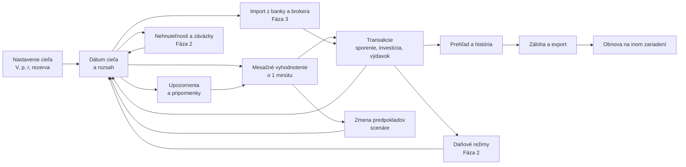

# 10 – Mapa produktu (návrh, brainstorming)

> Stav: **návrh na diskusiu**. Obsah nie je rozhodnutie ani záväzný plán. Každá položka je nápad alebo predpoklad, kým sa nezapíše do `08_Backlog_Napady.md` a potom do `Decisions.md`. Rozsah MVP je daný `04_Functional_Requirements.md`; tu zachytávame, kam by produkt mohol smerovať.

## 1. Mapa (ideálny stav)

Idea: jeden kľúčový výstup – **dátum cieľa** – a jedna **rutina** (mesačné vyhodnotenie). Všetko ostatné je vstup, ktorý ho mení, alebo vysvetlenie, prečo sa zmenil.

## 2. Vrstvy

| Vrstva | Obsah | Stav |
|---|---|---|
| Jadro | cieľ, dátum, dopad, vyhodnotenie, prah, zdroj úhrady, história | MVP, v kóde (M1–M4 podľa `06_Roadmap.md`) |
| Dostupnosť a dáta | offline, PWA, export/import, pripomienka zálohy | M5–M7 |
| Pilot | 3 mesiace reálneho používania, bez zmien výpočtu | Fáza 1b |
| Nehnuteľnosti a záväzky | čistá hodnota, hypotéka, nájom | Fáza 2, FR-20 až FR-28, `09_Navrh_Nehnutelnosti_Dane.md` |
| Daňové režimy | scenár po dani pre investície a nájom | Fáza 2 (D-083, D-086) |
| Napojenia | import z banky a brokera, automatické oceňovanie | Fáza 3 (`06_Roadmap.md`, §8 mimo plánu) |

## 3. Ideálny deň používateľa (scenár, nie požiadavka)

1. Otvorí aplikáciu a vidí **jedno číslo**: dátum cieľa a jeho zmenu od minulého mesiaca.
2. Zadá tri-štyri transakcie za týždeň (sporenie, investícia, výdavok) za menej ako 20 sekúnd na transakciu.
3. Na konci mesiaca spraví vyhodnotenie: zadá hodnotu investícií a nasporenú sumu. Dátum cieľa sa aktualizuje.
4. Ak výdavok presiahol prah alebo sa dátum posunul o viac než zvyčajne, dostane vysvetlenie v jednej vete.
5. Raz ročne skontroluje predpoklady (výnos, rezerva, výdavky) a potvrdí alebo zmení ich.

Zásada: žiadny krok nesmie vyžadovať, aby používateľ poznal finančnú teóriu. Aplikácia nemá odporúčať produkty (FR-13).

## 4. Nápady, ktoré ešte nie sú v backlogu (na diskusiu)

Každý riadok je **predpoklad**, kým ho nepotvrdí používanie alebo zdroj. Ak sa niečo ujme, zapíše sa do `08_Backlog_Napady.md`.

| # | Nápad | Prečo by mohol pomôcť | Riziko |
|---|---|---|---|
| M-01 | Stresové scenáre: čo ak výnos klesne na 0 % alebo výdavky vzrastú o 20 % | Ukáže citlivosť dátumu, nie len jedno číslo | Môže pôsobiť ako predpoveď; treba jasne označiť |
| M-02 | Porovnanie dvoch nastavení vedľa seba (napr. 3 % a 4 % výberu) | Lepšie chápanie dopadu jednej zmeny | Zvýši kognitívnu záťaž; len na vyžiadanie |
| M-03 | Pripomienka pred koncom mesiaca, nie len po jeho skončení | Vyhodnotenie sa neodkladá | Notifikácie na iOS sú obmedzené |
| M-04 | Štítky k transakciám (vlastné kategórie) | Pomôže N-03 bez zložitej klasifikácie | Ďalšie polia pri zápise |
| M-05 | Zdieľaný cieľ dvoch ľudí (partner) | Mnohé domácnosti plánujú spolu | Vlastníctvo a súkromie dát; nerozhodnuté |
| M-06 | Anglická / iná jazyková verzia | Širší okruh používateľov | Preklad právnych a finančných textov musí byť overený |
| M-07 | Tmavý režim a väčšie písmo ako predvolená voľba | Dostupnosť, M6 | Nie je to nový rozsah, len nastavenie |
| M-08 | Denník zmien predpokladov (kedy a prečo sa zmenil výnos) | Historická stopa pre pilot (Fáza 1b) | Mierne rozširuje históriu |

## 5. Čo mapa **nemá** obsahovať

- Odporúčanie konkrétneho produktu, banky alebo investičného nástroja (FR-13, D-061).
- Daňové alebo právne poradenstvo bez overeného zdroja (D-090).
- Automatické rozhodnutia za používateľa.
- Údaje, ktoré by odhaľovali konkrétnu osobu (osobné údaje v dokumentoch).

## 6. Odpovede vlastníka (2026-10-16)

1. **Jednoosobovosť:** v MVP je aplikácia jednoosobová. Neskôr bude mať charakter samostatnej aplikácie s niektorými zdieľanými časťami (M-05 je preto odložený na neskôr, nie do MVP).
2. **Rutina vs. dátum cieľa:** rutina je dôležitejšia. Dátum cieľa môže motivovať, ale podľa vlastníka menej.
3. **Pilot (Fáza 1b):** čo najskôr. Záleží na tom, či bude k dispozícii niekto, kto aplikáciu použije.

Tieto odpovede sú smer vlastníka, nie rozhodnutia. Ak sa majú stať záväznými, zapíšu sa do `Decisions.md` po potvrdení zakladateľa.
