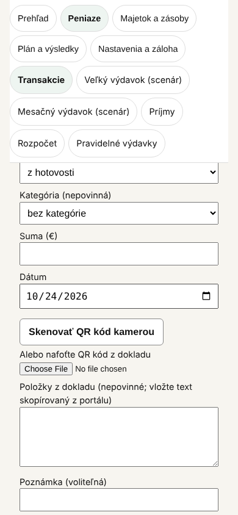
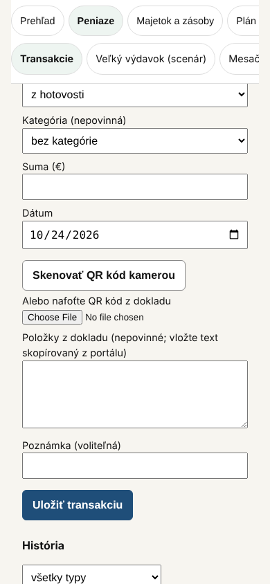
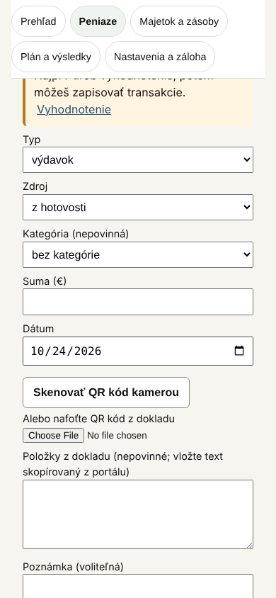
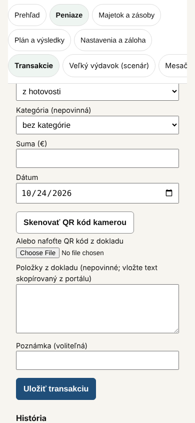

# 40 – Návrh: výška menu na telefóne

> Stav: **schválené (variant C) a implementované** (D-279, 2026-10-24). Nadväzuje na `docs/39`, oddiel 8. Merané 2026-10-24 v Playwright pri šírke 320 a 390 px a výške 844 px. Varianty som dočasne vyskúšal priamo v kóde a vrátil späť; v repozitári je len tento dokument a snímky. Mení sa len rozloženie menu, nie sekcie, texty ani dáta.

## 1. Problém

Horné menu je prilepené: pri posúvaní ostáva hore. Pri skupinách s viacerými sekciami (Peniaze má šesť) sa riadok sekcií zalomí do viacerých riadkov a menu zaberie veľkú časť obrazovky.

| Súčasný stav | 390 px | 320 px |
| --- | --- | --- |
| Prilepené menu, skupina Peniaze | 267 px (32 % výšky) | 369 px (44 % výšky) |
| Prilepené menu, Majetok a zásoby | 215 px | 265 px |
| Prilepené menu, Prehľad (bez sekcií) | 111 px | 161 px |
| Nadpis Transakcií pri otvorení (od hornej hrany) | 621 px | 768 px |

Pri 320 px je nadpis Transakcií po otvorení takmer pod spodným okrajom obrazovky.

## 2. Varianty

**A – oba riadky v jednom posúvateľnom riadku.** Skupiny aj sekcie sú každá v jednom riadku, ktorý sa posúva prstom do strany.
- Najmenšie menu, rovnaké vo všetkých skupinách.
- Nevýhoda: dve z piatich skupín („Plán a výsledky“, „Nastavenia a záloha“) nie sú pri 390 px vidieť bez posunutia. Testeri ich môžu prehliadnuť.

**B – prilepené len skupiny.** Riadok sekcií sa posúva so stránkou.
- Pri posúvaní je menu malé.
- Nevýhoda: pri otvorení sekcie nadpis začína rovnako nízko ako teraz. Na prepnutie sekcie treba vyrolovať hore.

**C – skupiny celé, sekcie v jednom posúvateľnom riadku (odporúčam).** Päť skupín ostane viditeľných ako teraz (dva riadky), sekcie sú v jednom riadku, ktorý sa posúva do strany.
- Všetky hlavné oblasti sú stále viditeľné.
- Orezaný posledný štítok vpravo (napr. „Mesač…“) ukazuje, že riadok pokračuje.

| Variant | 390 px: Peniaze | 390 px: nadpis Transakcií | 320 px: Peniaze | 320 px: nadpis Transakcií |
| --- | --- | --- | --- | --- |
| Súčasný | 267 px | 621 px | 369 px | 768 px |
| A | 121 px | 475 px | 121 px | 520 px |
| B | 111 px | 631 px | 161 px | 778 px |
| **C** | **167 px** | **521 px** | **217 px** | **616 px** |

Vo všetkých variantoch bez vodorovného posúvania celej stránky (presah 0 px). **Oprava pri implementácii:** pôvodne tu stálo, že pri 1280 px sa nič nemení. To som nemeral a neplatilo: šesť sekcií skupiny Peniaze sa do šírky obsahu 720 px nezmestí. Preto sa riadok sekcií posúva do strany len na úzkej obrazovke a od 600 px sa zalomí ako predtým.

## 3. Snímky (390 px, formulár Transakcií posunutý nadol)

| Súčasný | A | B | C |
| --- | --- | --- | --- |
|  |  |  |  |

## 4. Odporúčanie

**Variant C.** Šetrí 100 px pri 390 px a 152 px pri 320 px v skupine Peniaze, nadpis sekcie sa dostane o 100 až 152 px vyššie a všetkých päť hlavných oblastí ostane viditeľných. Je to najmenšia zmena správania: pribudne len posúvanie riadku sekcií do strany.

## 5. Implementácia po schválení

1. Test najprv: E2E test, že pri 390 px má prilepené menu v skupine Peniaze najviac 180 px a stránka nemá vodorovný presah.
2. `src/ui/Navigacia.tsx`: riadok sekcií bez zalamovania, s posúvaním do strany. Aktívna sekcia sa po otvorení posunie do viditeľnej časti riadku, aby nebola skrytá vpravo.
3. Overenie: `tsc`, `vitest`, celé Playwright vrátane testov dostupnosti a šírky 320 px, snímky 390 a 1280 px.
4. Zápis rozhodnutia do `decisions/Decisions.md`.

## 6. Mimo tohto návrhu

- Nad menu je pruh „Skúšobná verzia“ a úvodný text. Pri 390 px zaberajú spolu asi 350 px a posúvajú obsah nadol pri každom otvorení. Riešenie (napríklad zbaliteľný pruh) by bolo samostatným návrhom, lebo pruh obsahuje dôležité upozornenie.

## 7. Výsledok implementácie (2026-10-24)

- `src/ui/Navigacia.tsx`: riadok sekcií má triedu `nav-sections`. Aktívna sekcia sa po otvorení posunie do viditeľnej časti riadku; posúva sa riadok, nie stránka.
- `index.html`: trieda `nav-sections` — jeden riadok s posúvaním do strany, od 600 px zalamovanie.
- Testy v `tests/e2e/nav-scroll.spec.ts`: menu v skupine Peniaze pri 390 px najviac 180 px a bez presahu stránky (pred zmenou 267 px); aktívna posledná sekcia viditeľná po otvorení; pri 1280 px všetky sekcie viditeľné bez posúvania riadku.
- Overenie: `tsc` bez chýb, `vitest` 489 testov (86 súborov), Playwright 412 testov vrátane testov dostupnosti a šírky 320 px. Snímky pri 390 a 1280 px skontrolované.

