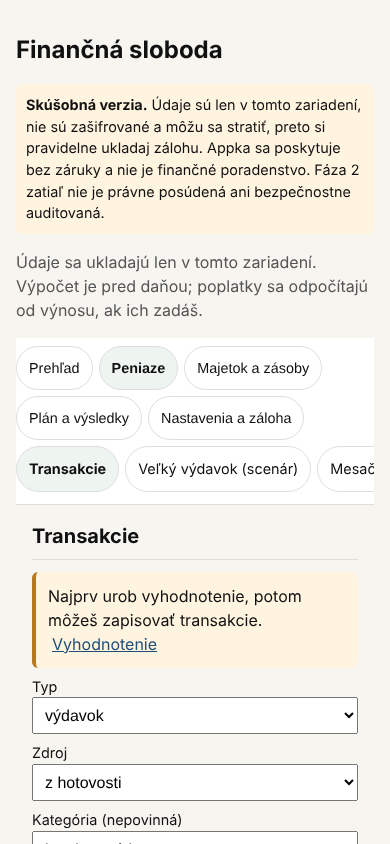
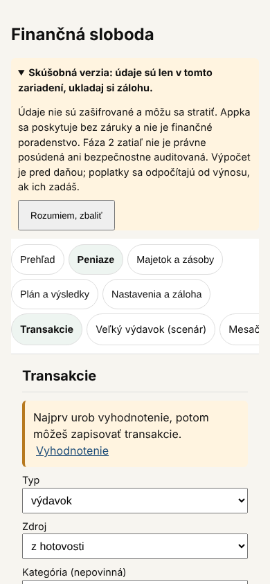
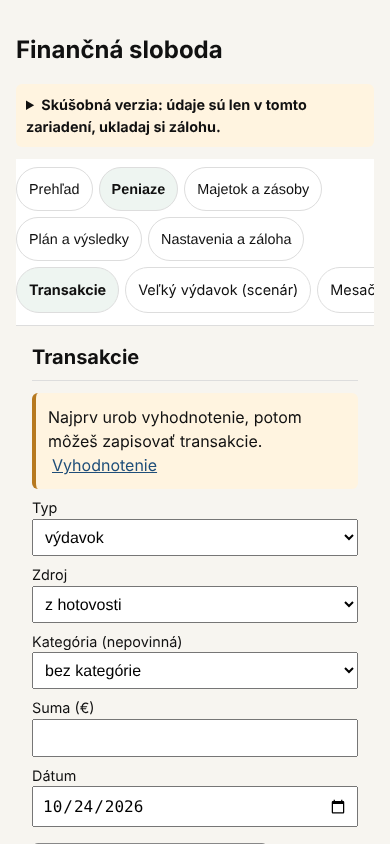

# 42 – Návrh: zbaliteľný pruh „Skúšobná verzia“

> Stav: **návrh na schválenie** (2026-10-24). Nadväzuje na `docs/40`, oddiel 6. Merané 2026-10-24 v Playwright na zostave s Fázou 2 pri šírke 320, 390 a 1280 px (výška 844 a 800 px). Varianty som vyskúšal len úpravou stránky v prehliadači; kód sa zatiaľ nemení. Obsah upozornenia predpisuje D-144 a zostáva rovnaký. Mení sa len to, kedy je celý text rozbalený.

## 1. Problém

Nad menu je nadpis appky, pruh „Skúšobná verzia“ a úvodná veta („Údaje sa ukladajú len v tomto zariadení. Výpočet je pred daňou…“). Pruh nie je prilepený, ale appka sa pri každom prepnutí sekcie vráti na začiatok stránky. Preto ich používateľ vidí po každom ťuknutí v menu a obsah sekcie začína nízko.

| Súčasný stav | 320 px | 390 px | 1280 px |
| --- | --- | --- | --- |
| Pruh (výška) | 171 px | 150 px | 85 px |
| Začiatok menu od hornej hrany | 383 px | 338 px | 249 px |
| Nadpis Transakcií od hornej hrany | 616 px | 521 px | 434 px |

Úvodná veta opakuje časť pruhu („len v tomto zariadení“). Dnes žiadny test nekontroluje, či upozornenie podľa D-144 je v appke celé.

## 2. Varianty

Vo všetkých variantoch sa úvodná veta presunie do pruhu, takže sa už neopakuje. Zbalený pruh má jeden súhrn, ktorý je vidieť stále: **„Skúšobná verzia: údaje sú len v tomto zariadení, ukladaj si zálohu.“** Ťuknutím na súhrn sa rozbalí celý text. Je to natívny prvok `details`, takže funguje aj klávesnicou a čítačkou obrazovky.

**A – pri prvom otvorení rozbalený, potom zbalený (odporúčam).** Pri prvom otvorení na zariadení je pruh rozbalený a má tlačidlo **Rozumiem, zbaliť**. Po ťuknutí ostane zbalený, aj po zatvorení appky. Rozbaliť sa dá kedykoľvek.
- Každý používateľ uvidí celé upozornenie aspoň raz a zbalí ho sám.
- Appka sa správa predvídateľne: pruh sa sám od seba nerozbaľuje ani nezbaľuje.
- Ak sa obsah upozornenia neskôr podstatne zmení, pruh sa na každom zariadení znova rozbalí (voľba sa ukladá s číslom verzie textu).

**B – vždy zbalený.** Najjednoduchšie, bez ukladania voľby.
- Nevýhoda: nový používateľ nemusí nikdy vidieť „bez záruky“ ani „nie je finančné poradenstvo“. To oslabuje D-144, preto ho neodporúčam.

**C – celý na Prehľade, inde zbalený.** Bez ukladania voľby.
- Nevýhoda: Prehľad sa otvára ako prvý, takže pri každom spustení appky je menu stále nízko (338 px pri 390 px). Pruh sa navyše mení podľa sekcie, čo je menej predvídateľné.

| Variant a stav | 320 px: menu | 320 px: nadpis Transakcií | 390 px: menu | 390 px: nadpis Transakcií | 1280 px: nadpis Transakcií |
| --- | --- | --- | --- | --- | --- |
| Súčasný | 383 px | 616 px | 338 px | 521 px | 434 px |
| A pri prvom otvorení (rozbalený) | 367 px | 600 px | 345 px | 528 px | 446 px |
| **Zbalený (A po potvrdení, B, C mimo Prehľadu)** | **159 px** | **392 px** | **159 px** | **342 px** | **325 px** |

Zbalený pruh je vysoký 63 px pri 320 a 390 px a 44 px pri 1280 px. Vo všetkých variantoch je stránka bez vodorovného presahu (0 px).

## 3. Snímky (390 px, Transakcie)

| Súčasný | A pri prvom otvorení | Zbalený |
| --- | --- | --- |
|  |  |  |

## 4. Odporúčanie

**Variant A.** Pri 390 px začína menu o 179 px vyššie (pri 320 px o 224 px) a prvé pole formulára je na obrazovke bez posúvania. Celé upozornenie podľa D-144 ostáva v appke a každý ho pri prvom otvorení vidí rozbalené. Najdôležitejšia veta o riziku straty údajov je viditeľná stále.

## 5. Riziká a upozornenia

- **Právne:** D-144 vyžaduje upozornenie, ale nehovorí, či musí byť stále rozbalené. Variant A ho po potvrdení zbalí. Právne to nikto neposúdil (D-028, D-090). Navrhujem doplniť túto otázku do `docs/Podklad_pravne_posudenie.md` (bod 5). Ak právne posúdenie bude vyžadovať stále viditeľné „bez záruky“ a „nie je finančné poradenstvo“, súhrn sa dá doplniť; pri 390 px by mal 3 riadky namiesto 2.
- **Výpočtová veta:** „Výpočet je pred daňou; poplatky sa odpočítajú od výnosu, ak ich zadáš“ bude po zbalení skrytá. Podobná veta („Odhad je pred daňou a poplatkami…“) je pri scenároch Veľký a Mesačný výdavok a pri nedosiahnuteľnom cieli. Pri dátume cieľa na Prehľade však nie je. Preto navrhujem doplniť ju na Prehľad pod dátum cieľa, k číslu, ktorého sa týka. Druhá možnosť je nechať ju nad menu ako samostatnú vetu; menu by potom začínalo o 68 px nižšie (pri 320 aj 390 px).
- **Súkromie:** voľba „zbalené“ sa ukladá len v prehliadači (`localStorage`), rovnako ako preskočenie prvého nastavenia. Nie je v zálohe, neobsahuje finančné údaje a nikam sa neposiela (D-009, D-026).
- **Kognitívna záťaž:** zbalený pruh znižuje množstvo textu na každej obrazovke. Rozbalenie je jedno ťuknutie a stav sa nemení sám.

## 6. Otázky na rozhodnutie

1. Variant: **A (odporúčam)**, B alebo C?
2. Úvodná veta: **presunúť do pruhu a vetu o dani doplniť pod dátum cieľa na Prehľade (odporúčam)** / nechať ju nad menu samostatne.
3. V rozbalenom pruhu pridať odkaz **Záloha**, ktorý otvorí sekciu zálohy? **Áno (odporúčam)**, zbalený pruh tým nebude vyšší.

## 7. Implementácia po schválení

1. Test najprv:
   - Jednotkový test, že text pruhu obsahuje všetky časti z D-144: len v zariadení, nie je zašifrované, môže sa stratiť, bez záruky, nie je finančné poradenstvo, Fáza 2 nie je právne posúdená ani bezpečnostne auditovaná.
   - E2E test:
     - pri prvom otvorení je pruh rozbalený;
     - po **Rozumiem, zbaliť** je zbalený aj po obnovení stránky;
     - súhrn ho znova rozbalí;
     - pri 390 px začína menu najviac na 170 px a stránka nemá vodorovný presah.
2. `src/ui/Shell.tsx`: pruh ako `details` so súhrnom, celým textom, odkazom Záloha a tlačidlom. Text bude v jednej konštante, z ktorej číta test. Voľba sa uloží pod kľúčom s verziou textu. Pri voľbe 2 podľa odporúčania aj veta o dani pod dátumom cieľa v `src/features/prehlad/Prehlad.tsx`.
3. Overenie: `tsc`, `vitest`, celé Playwright vrátane testov dostupnosti, snímky pri 320, 390 a 1280 px.
4. Zápis rozhodnutia do `decisions/Decisions.md` (spresňuje D-144, obsah sa nemení) a bod do podkladu pre právne posúdenie.

## 8. Nález mimo tohto návrhu

Prehľad píše „nominálne ≈ … pri inflácii 2 % (predpoklad)“ (`src/features/prehlad/Prehlad.tsx:99`). Výpočet však od D-263 používa infláciu 4,2 %, takže text uvádza iné číslo, než z ktorého počíta. Je to zavádzajúce finančné tvrdenie. Oprava je samostatná: text bude brať hodnotu z `RETURN_ASSUMPTIONS.inflation` a test overí, že sa zhoduje.
