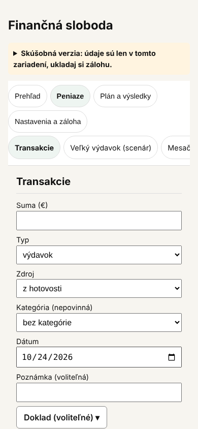
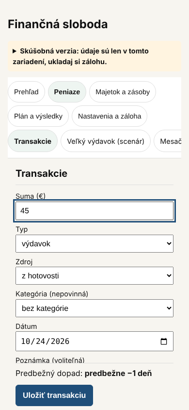
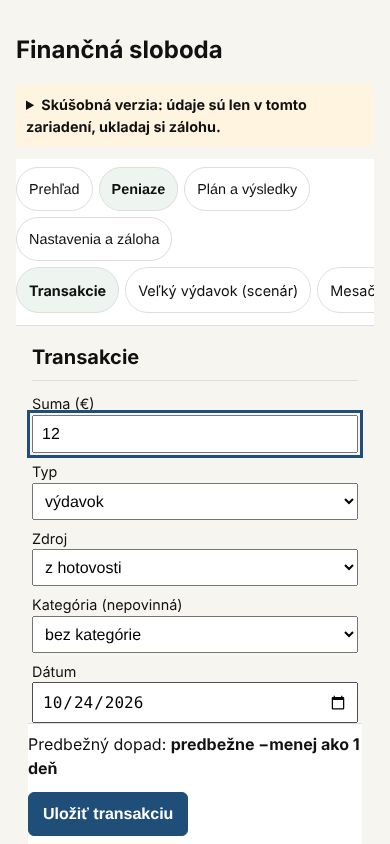

# 43 – Hodnotenie stavu a návrhy (2026-10-24)

> Stav: **čiastočne schválené a implementované** (2026-10-24). Zakladateľ schválil A1, C1 a C2 a zbalenie Modulov na telefóne. A1 a zbalenie Modulov sú D-283, C1 je D-284, A3 je D-286 a prilepené Uložiť (P1) je D-287 (oddiel 8). Predvolený zdroj výdavku „z príjmu“ je D-288. C2 už bolo vyriešené skôr (D-132), pozri opravu v oddiele 3. Výsledok je v oddiele 6. Ostatné body čakajú na rozhodnutie.
>
> Hodnotenie písal ten istý autor ako väčšinu kódu a dokumentov, preto **nie je nezávislou revíziou**. Každé tvrdenie je podložené meraním alebo odkazom; odporúčam ho dať na externú revíziu (samostatná konverzácia, CLAUDE.md).
>
> Merané na vetve `claude/phase2-property-card` (commit `41dacde`), zostava s Fázou 2, telefón 390 × 844 px. Dáta: testovacia záloha (`public/testovacia-zaloha.json`), ročné výdavky 24 000 €, pruh „Skúšobná verzia“ zbalený.

## 1. Zhrnutie

**Čo funguje dobre (overené):**
- Appka beží bez servera a nič neodosiela (CSP `connect-src 'self'`, sieťový test, D-242).
- 499 jednotkových a 418 E2E testov, `npm audit` bez zraniteľností (`docs/27`).
- Šifrovaná záloha (D-276), PIN s oneskorením (D-203), moduly na skrytie sekcií (D-162).
- Rozhodnutia sú zapísané a dohľadateľné (D-001 až D-282).

**Hlavné slabiny:**
1. **Hlavný údaj je schovaný.** Dátum cieľa je na Prehľade až na 937 px, teda pod spodným okrajom obrazovky (844 px). Nad ním sú upozornenie, Tento mesiac a Týždenný súhrn.
2. **Appka ukazuje stav, nie vývoj.** Mesačné vyhodnotenia sa ukladajú, ale nikde nie je vidieť, či sa cieľ približuje a o koľko.
3. **Zadanie výdavku je dlhšie, než musí byť.** Tlačidlo Uložiť transakciu je na 1 144 px. Medzi sumou a tlačidlom sú polia dokladu (QR kód, súbor, položky). História má pri výdavku tri tlačidlá (Prílohy, Upraviť, Zmazať). Pri 12 záznamoch je to 34 tlačidiel, z toho 12 červených „Zmazať“.
4. **Veľký rozsah.** Appka má 16 sekcií. Kto preskočí sprievodcu, má zapnuté všetky moduly (`src/app/modules.ts`: bez uloženej voľby sú zapnuté všetky). Sklad, recepty, psy a tlačivo 17-dp-md sú ďaleko od jadra appky (cieľ, výdavky, vyhodnotenie).
5. **Prvé načítanie.** Hlavný balík má 255 KB po kompresii. Odhadom 120 KB z toho je knižnica skenera čiarových kódov (`@zxing/library`), ktorú používa len Sklad. Odhad je z balíka knižnice samotnej, presnú úsporu treba overiť meraním.

## 2. Merania (390 × 844 px)

| Obrazovka | Dĺžka stránky | Polia | Tlačidlá | Slová | Poznámka |
| --- | --- | --- | --- | --- | --- |
| Prehľad | 1 868 px | 7 | 1 | 132 | dátum cieľa na 937 px; „Pridať transakciu“ na 1 145 px |
| Transakcie | 3 079 px | 12 | 36 | 332 | suma na 615 px, Uložiť na 1 144 px |
| Nastavenia | 2 403 px | 17 | 4 | 184 | blok Moduly je aj na Prehľade |
| Rozpočet | 1 857 px | 12 | 1 | 145 | |
| Dane | 1 675 px | 0 | 2 | 176 | |
| Ročný prehľad | 1 730 px | 0 | 0 | 191 | |
| Vyhodnotenie | 1 346 px | 3 | 5 | 73 | dve uložené vyhodnotenia, bez vývoja v čase |
| Ostatné (9 sekcií) | 844 až 1 321 px | 0 až 2 | 0 až 3 | 22 až 111 | |

Kód: 9 669 riadkov v `src`, najväčší súbor `src/features/majetok/Majetok.tsx` (781 riadkov), 467 inline štýlov (`style={{`, D-278 ich migruje postupne).

## 3. Návrhy

Náročnosť: S = do pol dňa, M = 1 až 2 dni, L = viac. Každý návrh by prešiel bežným postupom: návrh v `docs/`, schválenie, test najprv, implementácia.

### A – Jadro appky

**A1 Prehľad: dátum cieľa a pokrok hore** (S–M, odporúčam ako prvé)
- Poradie: **Dátum cieľa**, pod ním **pokrok** (napr. „Máš 304 000 € z 600 000 €, 51 %“) a **zmena od minulého vyhodnotenia** (napr. „o 2 mesiace bližšie“). Potom „Pridať transakciu“, upozornenia, Tento mesiac a Týždenný súhrn.
- Prínos: hlavný údaj aj hlavná akcia sú na prvej obrazovke bez posúvania.
- Riziká:
  - Pokrok v percentách nesmie pôsobiť ako tlak (`docs/03`, zásada 2 „Informácia, nie tlak“). Ukázať ho vecne, bez hodnotenia.
  - Pokrok musí počítať s rovnakou cieľovou sumou ako dátum cieľa, vrátane nehnuteľností v prenájme. Potrebuje vlastný golden test.
- **Konflikt:** blok Moduly je na Prehľade na žiadosť zakladateľa (D-164). Na telefóne je pod obsahom a zaberá asi 470 px. Navrhujem ho na telefóne zbaliť, nie odstrániť. Rozhodne zakladateľ.

**A2 Vývoj v čase** (M, nová funkcia)
- Graf hodnoty K z uložených vyhodnotení a vodorovná čiara cieľovej sumy. Pod ním ako sa menil dátum cieľa po mesiacoch. Údaje už existujú (mesačné vyhodnotenia).
- Graf bez novej knižnice (vlastné SVG), s textovou tabuľkou pre čítačky obrazovky.
- Prínos: odpovedá na otázku „približujem sa?“, ktorú appka dnes nezodpovie.
- Riziko: dátum cieľa pre staršie mesiace treba prepočítať s dnešnými nastaveniami, inak sa čísla nedajú porovnať. Treba to v grafe napísať.

**A3 Rýchlejšie zadanie výdavku** (M)
- **Suma** ako prvé pole. Doklad (QR kód, súbor, položky) zbalený pod „Doklad (voliteľné)“. Tlačidlo Uložiť sa tak dostane z 1 144 px nad spodný okraj obrazovky. **Oprava (2026-10-24):** toto tvrdenie bol neoverený odhad. Meranie ukázalo, že tlačidlo sa posunie na 975 px, stále pod okraj obrazovky (oddiel 8).
- V histórii len „Upraviť“ pri zázname; Prílohy a Zmazať (s potvrdením, D-199) budú v úprave. Pri 12 záznamoch je to 12 tlačidiel namiesto 34.
- Riziko: mení zaužívaný postup a veľa E2E testov (zmazanie, prílohy). Zmazanie ostane s potvrdením.

### B – Nová funkcia

**B1 „Čo ma najviac vzďaľuje“: opakované výdavky** (M)
- Pre každú kategóriu a pravidelný výdavok mesačný priemer za posledné 3 mesiace a koľko mesiacov posúva dátum cieľa. Používa výpočet z N-12b (`src/domain/monthlyExpense.ts`).
- Vychádza z poznámky zakladateľa: „finančnú slobodu nám oddaľujú skôr menšie opakované rozhodnutia“.
- Riziká:
  - Nesmie hodnotiť ani radiť, len ukázať čísla (`docs/03`; odlíšiť od finančného poradenstva, D-028).
  - Pri menej ako 2 až 3 mesiacoch dát je priemer nespoľahlivý, vtedy sa nezobrazí.
  - Prepojenie s N-03 (pravidelná vs. cielená spotreba, D-038).

### C – Kvalita a technika

**C1 Skener načítať až v Sklade** (S): `@zxing/library` načítať až pri otvorení skenera, ako je to dnes pri `jsqr` a `pdf-lib`. Odhad: prvé načítanie o 120 KB menej (asi o 47 %). Overiť meraním pred a po.

**C2 Limit veľkosti zálohy** — **oprava hodnotenia: už vyriešené.** Pôvodne tu stálo, že súbor zálohy sa načíta bez kontroly veľkosti (A-02 v `docs/27`). To bolo nesprávne. Vychádzal som zo súhrnu auditu a stĺpec so stavom v tabuľke nálezov som neskontroloval. Limit 100 MB existuje (`BACKUP_MAX_BYTES` v `src/storage/backup.ts`, kontrola v `src/features/zaloha/BackupSection.tsx`, D-132, test `tests/backup-size.test.ts`). Zistené pri implementácii 2026-10-24; kód sa nemenil.

**C3 Údržba** (S): Playwright 1.56 → 1.64 (len vývoj), `idb` 8.0.0 → 8.0.4, `fake-indexeddb` 6.0 → 6.2. GitHub akcie hlásia ukončenie podpory Node 20. `@zxing/library` hlási ako najnovšiu nižšiu verziu (0.21.3) než nainštalovanú (0.23.0), čo treba vysvetliť. Navrhujem najprv report agenta `dependencies`, bez zmien.

**C4 Predvolené moduly pri preskočení sprievodcu** (S–M): dnes sa zapnú všetky. Návrh: na novom zariadení bez dát len jadro. **Riziko:** používateľ s dátami bez uloženej voľby by po aktualizácii prišiel o sekcie z menu. Zmena preto smie platiť len pre zariadenie bez dát.

**C5 Postupné upratanie** (bez samostatnej úlohy): inline štýly a rozdelenie `Majetok.tsx` len vtedy, keď sa tie súbory aj tak menia.

### D – Rozhodnutia zakladateľa (nie kód)

- **D1 Čo má pilot overiť.** `docs/06`, oddiel 5 hovorí, že pilot overí, či sú dátum cieľa a predbežný dopad zrozumiteľné bez vysvetlenia. Testeri teraz dostávajú len zoznam úloh (`docs/41`). Návrh: doplniť 2 až 3 otázky k týmto bodom do formulára pripomienok.
- **D2 Rozsah.** Odporúčam nepridávať ďalšie okrajové moduly, kým pilot neoverí jadro (riziko „pretiahnutý rozsah“, `docs/06`, oddiel 4).
- **D3 Uchovanie dát na iPhone** (`docs/06`, oddiel 9): overenie po týždni neaktivity, pripomienka 2026-10-30.
- **D4 Brány G1–G5** sú otvorené. Zlúčenie do `main` je verejný krok; vykoná sa len na výslovný pokyn (D-248).

## 4. Odporúčané poradie

1. **A1 + C1** (C2 už bolo hotové): hlavný údaj na prvej obrazovke a rýchlejšie prvé načítanie. Malé, s veľkým prínosom. **Hotovo** (D-283, D-284).
2. **A3**: rýchlejšie zadanie výdavku.
3. **A2**, potom **B1**: vývoj v čase a opakované výdavky, ktoré na seba nadväzujú.
4. **C3** ako report, **C4** a body D podľa rozhodnutí.

## 5. Čo nenavrhujem

- Účty, synchronizáciu ani napojenie na banku: mimo plánu (D-148, G3) a veľké riziko pre súkromie.
- Knižnicu na grafy: stačí vlastné SVG, bez novej závislosti.
- Ďalšie moduly mimo jadra pred výsledkom pilotu (D2).

## 6. Výsledok implementácie A1, C1 a zbalenia Modulov (2026-10-24)

**A1 Prehľad (D-283)**
- Nové poradie Prehľadu:
  1. dátum cieľa (väčším písmom);
  2. pokrok, napr. „Pokrok: 50 % (304 000,00 € z 600 000,00 €)“, s pruhom;
  3. posun od predchádzajúceho vyhodnotenia, napr. „Od vyhodnotenia 31.08.2026 sa dátum cieľa posunul o 13 mesiacov bližšie.“;
  4. veta o dani, posledné vyhodnotenie a Podrobnosti;
  5. Pridať transakciu;
  6. upozornenia;
  7. Tento mesiac a Týždenný súhrn.
- Riadok „Cieľová suma“ je pokrok, keď už existuje vyhodnotenie. Bez vyhodnotenia sa zobrazuje ako predtým.
- Pokrok (`src/domain/progress.ts`, `goalProgress`) počíta s tým istým kapitálom ako zobrazený dátum cieľa, vrátane nehnuteľností v prenájme (hodnota mínus hypotéka). Percentá sa zaokrúhľujú nadol, takže 100 % sa ukáže až pri dosiahnutí cieľa.
- Posun (`goalDateShift`) porovná cieľový mesiac pri predchádzajúcom a poslednom vyhodnotení. Oba počíta s dnešnými nastaveniami, takže ukazuje len zmenu kapitálu. Nezobrazí sa bez predchádzajúceho vyhodnotenia ani pri nedosiahnuteľnom, dosiahnutom alebo vzdialenejšom ako 50 rokov cieli.
- Texty sú vecné, bez hodnotenia (`src/features/prehlad/progressText.ts`). Pruh pokroku je len ozdoba (`aria-hidden`), informáciu nesie text.
- Merané pri 390 × 844 px s testovacou zálohou:

| Prvok | Predtým | Teraz |
| --- | --- | --- |
| Dátum cieľa | 937 px | 345 px |
| Spodok tlačidla „Pridať transakciu“ | 1 189 px | 725 px |
| Dĺžka Prehľadu | 1 868 px | asi 1 550 px |

  Pri 1280 px je dátum cieľa na 276 px. Vodorovný presah je 0 px pri 390 aj 1280 px, v svetlom aj tmavom režime.

**Moduly na telefóne (D-283, spresňuje D-164)**
- Pod 700 px je blok Moduly na Prehľade zbalený pod tlačidlom „Moduly ▾“ a rozbalí sa ťuknutím.
- Od 700 px je v pravom stĺpci rozbalený ako predtým. V Nastaveniach sa nemení.

**C1 Skener (D-284)**
- `@zxing/library` sa načíta až pri použití skenera (`src/features/sklad/barcode.ts`).
- Sklad knižnicu načíta pri otvorení, aby ju offline cache uložila. Skener potom funguje bez siete, ak bol Sklad aspoň raz otvorený online. Rovnaké obmedzenie už mali čítačka QR kódu a tlačivo PDF.
- Hlavný balík (gzip):

| | Predtým | Teraz |
| --- | --- | --- |
| Hlavný balík | 254 900 B | 137 205 B (−46 %) |
| Hlavný balík bez kompresie | 926 KB | 475 KB |

- Pri tejto zmene skener zapína knižnicu pred kamerou. Ak sa skener zavrie počas pýtania povolenia, kamera sa hneď vypne. Predtým v takom prípade mohla ostať zapnutá.

**Testy**
- Jednotkové:
  - `tests/goal-progress.test.ts`: pokrok, nehnuteľnosti, hranice 0 až 100 % a posun bližšie, ďalej, bez zmeny a kedy sa nezobrazí;
  - `tests/progress-text.test.ts`: texty a tvary slova „mesiac“.
- E2E:
  - `tests/e2e/home-goal.spec.ts`: dátum cieľa a Pridať transakciu sú pri 390 px na prvej obrazovke;
  - `tests/e2e/modules.spec.ts`: Moduly zbalené na telefóne;
  - `tests/e2e/bundle.spec.ts`: hlavný balík neobsahuje knižnicu skenera;
  - `tests/e2e/skip-onboarding.spec.ts`: cieľová suma v riadku Pokrok.
- Overenie: `tsc` bez chýb, `vitest` 508 testov (90 súborov), Playwright 422 testov (211 × 2) vrátane skenovania falošnou kamerou.

## 7. Nález: dátum cieľa a transakcie po vyhodnotení (vyriešené, D-285)

Prehľad počíta dátum cieľa z kapitálu, ktorý obsahuje aj transakcie po poslednom vyhodnotení (`ctx.capital` v `src/domain/context.ts`, D-121). Skúšobný výpočet (`makeCtx` a `scenarioDateText`):
- posledné vyhodnotenie 100 000 € investícií a 20 000 € hotovosti;
- sporenie 500 € mesačne;
- po zápise výdavku 19 000 € z hotovosti sa dátum cieľa posunul z 02/2056 na 11/2056.

Dokumentácia pritom hovorí inak:
- FR-04: „Pracovný kapitál sa nepremieta do oficiálneho cieľa, kým sa neurobí vyhodnotenie.“
- D-024: dátum sa „mení len pri novom vyhodnotení“.
- Text pod dátumom: „Dátum sa zmení až po ďalšom vyhodnotení.“

Pokrok z A1 počítal s tým istým kapitálom ako dátum, aby si čísla neodporovali.

**Rozhodnutie (2026-10-24, D-285):** zakladateľ zvolil možnosť A, teda dátum podľa FR-04.
- Oficiálny dátum cieľa, jeho rozsah, upozornenie na dlhý horizont, pokrok a posun sa počítajú z kapitálu pri poslednom vyhodnotení (`ctx.evaluated`, K_L).
- Transakcie po vyhodnotení menia len pracovný kapitál (`ctx.capital`, K_pred) a predbežný dopad.
- V Podrobnostiach je „Kapitál pri vyhodnotení“. Ak sa pracovný kapitál líši, pod ním je aj riadok „Po transakciách od vyhodnotenia (predbežne)“.
- Scenáre Veľký a Mesačný výdavok aj predbežný dopad vo formulári transakcie ostávajú na pracovnom kapitáli (FR-04, `docs/36`). Ich „dátum cieľa bez výdavku“ sa preto môže líšiť od dátumu na Prehľade, kým sa transakcie po vyhodnotení neprenesú do nového vyhodnotenia.
- Testy:
  - `tests/context.test.ts`: výdavok po vyhodnotení nezmení dátum ani rozsah;
  - `tests/e2e/home-goal.spec.ts`: dátum a pokrok sa po výdavku nezmenia, predbežný dopad áno;
  - `same-day-evaluation` a `forgotten-expense` kontrolujú pracovný kapitál v novom riadku.

## 8. Výsledok implementácie A3 (2026-10-24, D-286)

**Čo sa zmenilo** (`src/features/transakcie/Transakcie.tsx`)
- Poradie formulára: Suma, Typ, Zdroj, Kategória, Dátum, Poznámka, potom zbalený „Doklad (voliteľné)“, Predbežný dopad a Uložiť.
- Doklad (QR kamerou, fotka QR, priradený doklad, overenie na portáli, položky z dokladu) je zbalený. Sám sa rozbalí, keď v ňom niečo je: priradený doklad, uložené položky, správa o QR kóde, zapnutá kamera alebo vložený text. Chyby položiek tak nie sú skryté. Pri priradenom doklade má súhrn text „· priradený“.
- V histórii je pri zázname len **Upraviť**. Úprava je vo formulári hore a stránka sa na ňu posunie. V úprave sú **Prílohy** (pri výdavku) a **Zmazať transakciu** s potvrdením (D-199). Pruh „Transakcia bola zmazaná. Vrátiť späť“ je hneď pod formulárom, kde sa mazalo (D-160).

**Merané** (390 × 844 px, testovacia záloha, pruh zbalený):

| | Predtým | Teraz |
| --- | --- | --- |
| Spodok tlačidla Uložiť pri 390 px | 1 188 px | 975 px |
| Spodok tlačidla Uložiť pri 320 px | 1 238 px | 1 025 px |
| Tlačidlá v histórii (12 záznamov) | 34 (z toho 12 „Zmazať“) | 12 („Upraviť“) |
| Dĺžka stránky pri 390 px | 3 079 px | 2 869 px |

**Čo sa nesplnilo:** tlačidlo Uložiť je stále pod spodným okrajom obrazovky (844 px). V návrhu A3 som tvrdil opak bez merania. Možnosti na zvyšný rozdiel, vyskúšané úpravou stránky v prehliadači:

| Možnosť | 390 px | 320 px | Poznámka |
| --- | --- | --- | --- |
| **P1 Prilepený pruh dole:** Predbežný dopad a Uložiť sú na telefóne stále na spodku obrazovky | 836 px | 836 px | Nič sa neskrýva; tlačidlo je vždy na tom istom mieste. Pruh zakrýva spodných asi 100 px obsahu, kým sa nescrolluje. Na iPhone treba overiť správanie s otvorenou klávesnicou. |
| **P2 Dva stĺpce** (Typ a Zdroj, Kategória a Dátum vedľa seba) **a Poznámka v zbalenom bloku** | odhad asi 815 px | odhad asi 995 px | Odhad zložený z dvoch samostatných meraní (stĺpce −109 px, poznámka −68 px pri 390 px). Pri 320 px sa stĺpce zložia pod seba, takže pomôže len poznámka. Poznámku používa väčšina záznamov v testovacích dátach, takže by pribudlo ťuknutie. |

Odporúčam **P1**: funguje pri každej šírke a nič neskrýva. **Zakladateľ zvolil P1 (D-287), implementované:** predbežný dopad, prípadná chyba a tlačidlá Uložiť (v úprave aj Zrušiť úpravu) sú v pruhu prilepenom na spodku obrazovky. Upozornenia a potvrdenie vyčerpania investícií ostávajú vo formulári nad pruhom. Uložiť je pri 390 aj 320 px na 836 px, v svetlom aj tmavom režime, bez vodorovného presahu. Na iPhone overené 2026-10-25: pri otvorenej klávesnici je pruh pod ňou, po zatvorení viditeľný; zakladateľ to nechal tak (D-295).

**Testy**
- Nový `tests/e2e/transactions-quick.spec.ts`:
  - suma je prvé pole;
  - doklad je zbalený;
  - v histórii je pri zázname len Upraviť;
  - úprava sa ukáže hore, v úprave sú Prílohy a Zmazať a zmazanie sa dá vrátiť.
- Upravené na nový postup: `home`, `attachments`, `receipt-items`, `receipt-camera`, `transactions-filter`.
- P1 a D-288: `tests/e2e/transactions-quick.spec.ts` (Uložiť a predbežný dopad sú pri 390 aj 320 px na obrazovke; predvolený zdroj „z príjmu“). V `m3-transactions` a `threshold` sa zmenil len očakávaný text riadku na „(z príjmu)“.
- Overenie: `tsc` bez chýb, `vitest` 511 testov (90 súborov), Playwright 428 testov (214 × 2) po A3 a 432 testov (216 × 2) po P1 a D-288.

**Nález mimo A3:** D-014 a `docs/03` určujú predvolený zdroj výdavku „z príjmu“. Formulár mal od revízie 2026-10-15 predvolene „z hotovosti“ a rozhodnutie, ktoré by D-014 menilo, som nenašiel. **Zakladateľ potvrdil „z príjmu“ (D-288), opravené:** nový výdavok má predvolene „z príjmu“. Pri takom výdavku sa kapitál nemení a predbežný dopad je „bez zmeny“, preto som túto vetu doplnil do úlohy 2 v `docs/41`. Scenár Veľký výdavok má vlastný predvolený zdroj „z hotovosti“ (D-274) a nemení sa.

