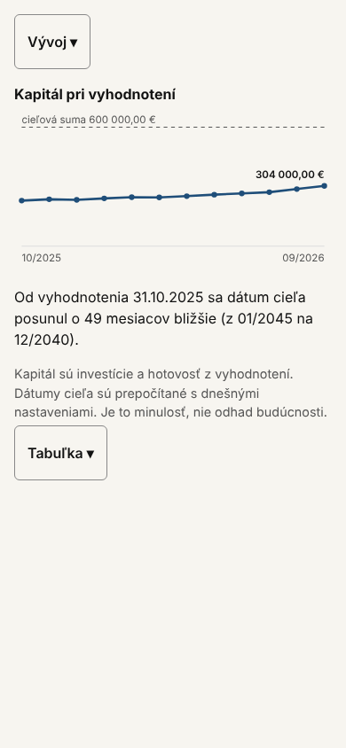
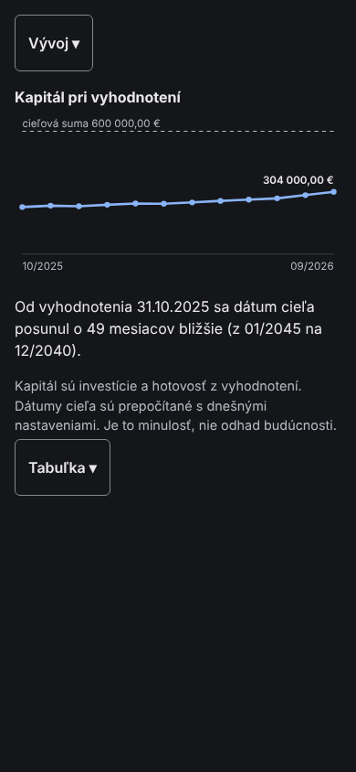
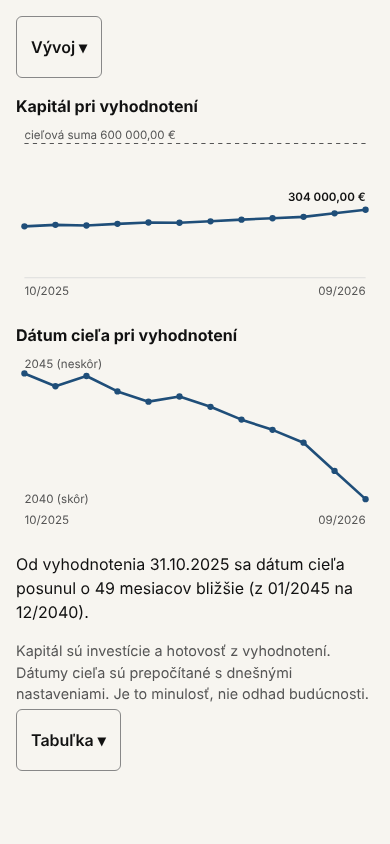
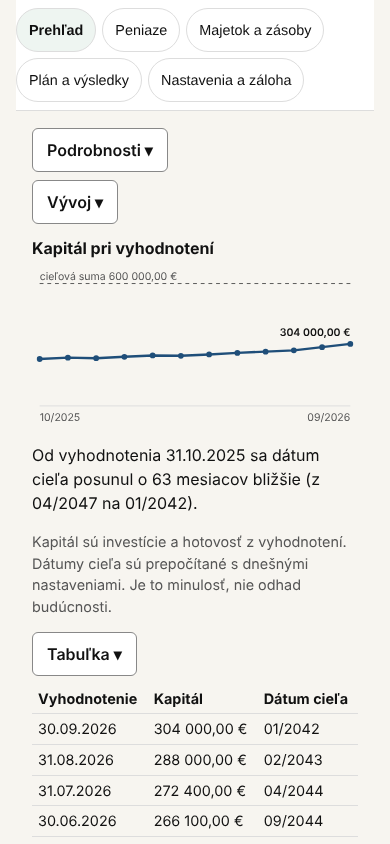
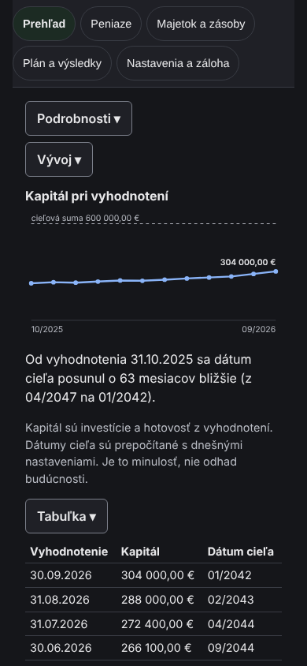

# 44 – Návrh: vývoj v čase (A2)

> Stav: **schválené (U1, A, N1, oprava textu) a implementované** (D-289, 2026-10-24). Nadväzuje na `docs/43`, návrh A2. Výsledok je v oddiele 10.
>
> Náčrty sú zo syntetických dát:
> - 12 mesačných vyhodnotení, kapitál z 230 000 € na 304 000 €;
> - cieľová suma 600 000 €, výnos r 3,5 %, sporenie 500 € mesačne.
>
> Dátumy cieľa v náčrtoch prepočítala funkcia appky `annualOverview` (`src/domain/annualOverview.ts`), takže zodpovedajú tomu, čo by appka ukázala.

## 1. Čo chýba

- Prehľad ukazuje stav a posun od minulého vyhodnotenia (D-283). Dlhší vývoj nikde nevidno.
- Údaje už existujú: mesačné vyhodnotenia, aj automatické (D-116), a ich prepočet v Ročnom prehľade (tabuľka „Vyhodnotenia“). Ročný prehľad je však voliteľný modul a ukazuje vývoj len textom, kartou pre každý mesiac.
- A2 preto nepotrebuje nový výpočet, len zobrazenie: použije tie isté riadky ako Ročný prehľad.

## 2. Kontrola rozhodnutí

| Rozhodnutie | Vzťah k A2 |
| --- | --- |
| D-008, `docs/06` oddiel 8: graf projekcie podľa výnosu a inflácie je odložený | A2 ukazuje len minulosť (uložené vyhodnotenia). Nič neodhaduje do budúcnosti. Čiara cieľovej sumy je dnešná cieľová suma, nie projekcia. Bez konfliktu. |
| D-016: graf rozsahu dátumov „neskôr“ | A2 ho nepridáva. Bez konfliktu. |
| `docs/00`, riziká: neustále prepočítavanie cieľa môže vyvolávať stres; treba zvážiť frekvenciu zobrazovania | Blok je zbalený a otvára ho používateľ, keď chce. |
| `docs/03`, zásada 2: informácia, nie tlak | Bez farieb hodnotenia (žiadna červená a zelená), vecný text. |
| `docs/43`, oddiel 5: bez knižnice na grafy | Vlastné SVG, bez novej závislosti. |

## 3. Umiestnenie

- **U1 – Prehľad, zbalené tlačidlo „Vývoj ▾“ vedľa „Podrobnosti ▾“ (odporúčam).** Prehľad je obrazovka, ktorú používateľ otvára najčastejšie. Zbalený blok nepredĺži stránku ani neposunie dátum cieľa a hlavnú akciu (D-283).
- **U2 – Vyhodnotenie, nad zoznamom uložených vyhodnotení.** Vyhodnotenie je od D-116 automatické, takže tam používateľ chodí zriedka.
- **U3 – Ročný prehľad, nad tabuľkou.** Je to voliteľný modul; kto ho vypne, vývoj neuvidí.

## 4. Obsah

**Variant A – jeden graf (odporúčam)**
- Graf „Kapitál pri vyhodnotení“: čiara kapitálu (investície a hotovosť) a prerušovaná čiara cieľovej sumy.
- Mierka grafu ide od 0 po cieľovú sumu, rovnako ako pruh pokroku. Mesačné zmeny sú preto len mierne stúpanie. Zväčšená mierka by ich ukázala výraznejšie, ale malé zmeny by vyzerali ako veľké, a to by bolo zavádzajúce (CLAUDE.md, pravidlá kvality).
- Pod grafom veta o posune dátumu cieľa od prvého vyhodnotenia, napr. „Od vyhodnotenia 31.10.2025 sa dátum cieľa posunul o 49 mesiacov bližšie (z 01/2045 na 12/2040).“
- Ďalej poznámka: „Kapitál sú investície a hotovosť z vyhodnotení. Dátumy cieľa sú prepočítané s dnešnými nastaveniami. Je to minulosť, nie odhad budúcnosti.“
- Zbalená tabuľka so stĺpcami vyhodnotenie, kapitál a dátum cieľa, najnovšie hore.
- Rozbalený blok má pri 390 px výšku 526 px.

**Variant B – dva grafy**
- Ako A, a navyše graf „Dátum cieľa pri vyhodnotení“.
- Približovanie k cieľu ukáže výraznejšie, ale číta sa opačne: nižšie znamená skôr, teda lepšie.
- Pre človeka, ktorý grafy bežne nečíta, je to ďalší krok navyše. Rozbalený blok má pri 390 px výšku 755 px.

| Variant A (390 px) | Variant A, tmavý režim | Variant B (390 px) |
| --- | --- | --- |
|  |  |  |

## 5. Pravidlá zobrazenia

- **Menej ako 2 vyhodnotenia:** namiesto grafu text „Vývoj sa ukáže po druhom vyhodnotení.“
- **Bez nastavení (bez cieľovej sumy):** graf bez čiary cieľa a bez vety; tabuľka len s kapitálom.
- **Dátum cieľa** pre každé vyhodnotenie je z `annualOverview`, rovnako ako v Ročnom prehľade a pri posune na Prehľade (D-283): uložený kapitál, dnešné nastavenia, nehnuteľnosti v prenájme podľa D-169.
- **Cieľ nie je dátum** (nedosiahnuteľný, viac ako 50 rokov, dosiahnutý): tabuľka to povie slovom a veta o posune sa nezobrazí.
- **Ktoré vyhodnotenia:** všetky, aj automatické; graf ukáže všetky body.
- **Prístupnosť:**
  - graf má `role="img"` a popis (obdobie, prvá a posledná hodnota, cieľová suma);
  - tabuľka je textová náhrada grafu;
  - farby sú z tokenov appky (`--primary-bg`, `--muted`) a fungujú v svetlom aj tmavom režime.

## 6. Otvorená otázka: nehnuteľnosti v prenájme

Pokrok (D-283) a dátum cieľa zahŕňajú nehnuteľnosti v prenájme (hodnota mínus hypotéka). Vyhodnotenia však ukladajú len investície a hotovosť; minulé hodnoty nehnuteľností sa neukladajú.

- **N1 (odporúčam):** graf ukáže len investície a hotovosť. Ak má používateľ nehnuteľnosť v prenájme, pod grafom bude veta: „Graf ukazuje investície a hotovosť. Nehnuteľnosti v prenájme v ňom nie sú, lebo ich minulé hodnoty sa neukladajú; pokrok na Prehľade ich zahŕňa.“
- **N2:** pripočítať ku každému bodu dnešnú čistú hodnotu nehnuteľností. Minulosť by tým bola skreslená, preto to neodporúčam.

Dátum cieľa v tabuľke nehnuteľnosti zahŕňa s dnešnými hodnotami, rovnako ako dnes Ročný prehľad.

## 7. Nález mimo návrhu

Ročný prehľad píše „Dátum cieľa sa počíta z uloženého K a z aktuálnych Nastavení, bez nehnuteľností.“ (`src/features/rocny-prehlad/RocnyPrehlad.tsx:33`). Od D-169 však výpočet nehnuteľnosti v prenájme zahŕňa (`annualOverview(…, ctx.rentals)`). Text navrhujem opraviť spolu s A2, napríklad: „Dátum cieľa sa počíta z uloženého K, z dnešných Nastavení a z dnešných hodnôt nehnuteľností v prenájme.“

## 8. Otázky na rozhodnutie

1. Umiestnenie: **U1 (odporúčam)**, U2 alebo U3?
2. Obsah: **A (odporúčam)** alebo B?
3. Nehnuteľnosti: **N1 (odporúčam)** alebo N2?
4. Opraviť text v Ročnom prehľade (oddiel 7)? **Áno (odporúčam)**.

## 9. Implementácia po schválení

Rozsah: 1 až 2 dni.

1. Test najprv:
   - jednotkové testy pre výpočet bodov grafu (mierka od 0 po cieľovú sumu, prvý a posledný bod, žiadne a jedno vyhodnotenie) a pre vetu o posune;
   - E2E test:
     - blok je zbalený;
     - po otvorení je graf s popisom, veta a tabuľka s toľkými riadkami, koľko je vyhodnotení;
     - pri jednom vyhodnotení je len oznam;
     - pri 320 a 390 px nie je vodorovný presah;
     - test dostupnosti prejde.
2. Kód:
   - `src/ui/kit/chartGeometry.ts`: čistá funkcia, ktorá z hodnôt vypočíta body;
   - `src/ui/kit/LineChart.tsx`: SVG;
   - `src/features/prehlad/Vyvoj.tsx`: blok Vývoj, používa `annualOverview`.
3. Overenie: `tsc`, `vitest`, celé Playwright, snímky pri 320, 390 a 1280 px v svetlom aj tmavom režime.
4. Zápis rozhodnutia do `decisions/Decisions.md`.

## 10. Výsledok implementácie (2026-10-24)

**Kód**
- `src/ui/kit/chartGeometry.ts`: čisté funkcie `chartY`, `chartPoints` a `chartMaxY` (mierka od 0, rezerva 5 %, hodnoty mimo mierky ostanú v grafe).
- `src/ui/kit/LineChart.tsx`: SVG s `role="img"` a popisom.
- `src/domain/progressHistory.ts`: `historyShift` (posun od prvého po posledné vyhodnotenie).
- `src/features/prehlad/progressText.ts`: `historyLine` a `goalCell` (mesiace v tvare MM/RRRR).
- `src/features/prehlad/Vyvoj.tsx`: blok „Vývoj ▾“ pod „Podrobnosti ▾“ na Prehľade.
- Oprava textu v Ročnom prehľade (oddiel 7): „…z uloženého K, z dnešných Nastavení a z dnešných hodnôt nehnuteľností v prenájme.“

**Merané** s testovacou zálohou, pruh zbalený, blok Vývoj zbalený:
- Spodok tlačidla „Pridať transakciu“:
  - pri 390 px na 777 px (predtým 725 px), stále na prvej obrazovke;
  - pri 1280 px na 684 px;
  - pri 320 × 844 px na 873 px, teda pod okrajom. Zariadenia so šírkou 320 px majú výšku obrazovky okolo 568 px, takže sa tam nezmestil ani predtým.
- Vodorovný presah je 0 px pri 320, 390 a 1280 px, v svetlom aj tmavom režime.

| Implementácia, 12 syntetických vyhodnotení (390 px) | Tmavý režim |
| --- | --- |
|  |  |

**Oprava skloňovania (pokračovanie T3 z `docs/30`)**
- Snímka ukázala „o 63 mesiace“. Funkcia `plural` (`src/domain/impact.ts`) dávala tvar „mesiace“ pre každé číslo končiace na 2 až 4.
- Zložená číslovka písaná dovedna má podstatné meno v genitíve plurálu: 22 mesiacov, 63 mesiacov, 24 dní. Tvar „mesiace“ ostáva len pre 2, 3 a 4.
- Oprava platí všade, kde appka skloňuje: predbežný dopad, posuny dátumu cieľa, Ročný prehľad, Sklad.
- Test GC-15 očakával „−154 mesiace“; `docs/07` aj názov testu uvádzajú „−154 mesiacov“, takže očakávanie som zosúladil s `docs/07`.

**Testy**
- Jednotkové:
  - `tests/chart-geometry.test.ts`;
  - `tests/progress-history.test.ts`;
  - nový prípad v `tests/impact-plural.test.ts`.
- E2E `tests/e2e/progress-history.spec.ts`:
  - Vývoj je zbalený;
  - po otvorení je graf s popisom, veta a tabuľka so všetkými vyhodnoteniami;
  - kontrola dostupnosti (axe) s otvoreným blokom;
  - 320 px bez presahu;
  - pri jednom vyhodnotení je len oznam;
  - pri nehnuteľnosti v prenájme sa zobrazí veta N1;
  - opravený text v Ročnom prehľade.
- Overenie: `tsc` bez chýb, `vitest` 520 testov (92 súborov), Playwright 438 testov (219 × 2).

