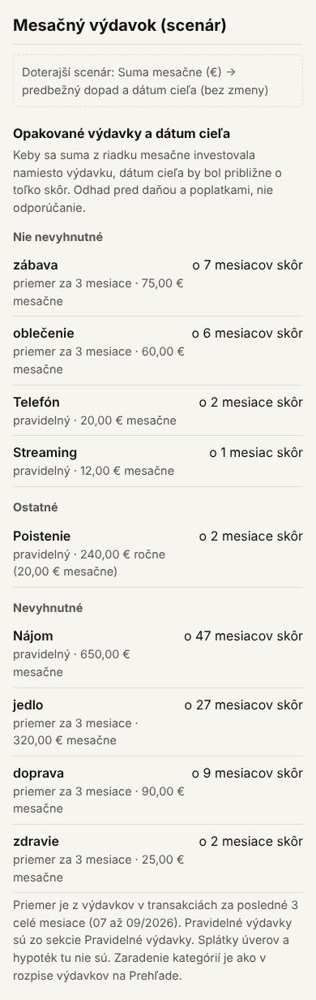
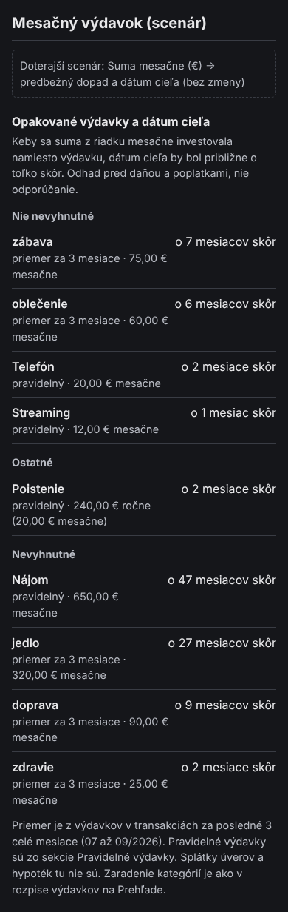

# 45 – Návrh: opakované výdavky a dátum cieľa (B1)

> Stav: **návrh na schválenie** (2026-10-24). Nadväzuje na `docs/43`, návrh B1. Kód sa zatiaľ nemení.
>
> Čísla v náčrte vypočítala funkcia appky `goalMonths`. Vstupy sú syntetické: kapitál 304 000 €, cieľová suma 600 000 €, r 3,5 %, sporenie 500 € mesačne do investícií. Dnes je cieľ o 171 mesiacov.

## 1. Cieľ

Zakladateľ: „finančnú slobodu nám oddaľujú skôr menšie opakované rozhodnutia“. Prehľad dnes ukazuje, koľko sa minulo, ale nie, čo opakované výdavky znamenajú pre dátum cieľa. B1 to ukáže pre každý pravidelný výdavok a pre každú kategóriu výdavkov: o koľko skôr by bol cieľ, keby sa táto suma mesačne investovala.

## 2. Kontrola rozhodnutí

| Rozhodnutie | Vzťah k B1 |
| --- | --- |
| D-038: prehľad spotreby „pravidelná vs. cielená“ je odložený do fázy 1b | B1 spotrebu na pravidelnú a cielenú nedelí. Ukazuje existujúce pravidelné výdavky (D-124) a priemery kategórií. Fáza 1b (pilot) práve beží. Bez konfliktu; súvisí s N-03. |
| D-124: pravidelné výdavky sú len zobrazenie | B1 ich len zobrazí; K ani sporenie sa nemenia. |
| D-131: zaradenie kategórií na nevyhnutné, nie nevyhnutné a ostatné | B1 použije to isté zaradenie (`NECESSITY` v `src/domain/monthSummary.ts`). |
| D-153 a `docs/17` oddiel 8: počas pilotu sa výpočty nemenia | B1 nemení výpočet cieľa. Je to nová informácia z existujúcej funkcie `goalMonths`, rovnako ako scenáre D-274 a D-275. Pozri však oddiel 6 (D-285). |
| D-275: mesačný výdavok znižuje najprv sporenie do investícií | B1 robí opak rovnakou cestou: suma sa pripočíta k sporeniu do investícií (otázka 3). |
| D-285: oficiálny cieľ je z kapitálu pri vyhodnotení | B1 počíta z toho istého kapitálu ako dátum na Prehľade. |
| `docs/03` zásada 2, D-028 | Texty sú vecné a bez hodnotenia; „odhad, nie odporúčanie“. |

## 3. Návrh

**Čo sa počíta**
- Pre každú položku s mesačnou sumou X: mesiace do cieľa dnes mínus mesiace do cieľa pri sporení do investícií väčšom o X. Zobrazí sa „o N mesiacov skôr“, pod 1 mesiac „menej ako 1 mesiac skôr“.
- Ak dnešný cieľ nie je dátum (nedosiahnuteľný alebo viac ako 50 rokov), zoznam sa nezobrazí. Namiesto neho bude oznam a tlačidlo Nastavenia (mesačné sporenie).

**Ktoré položky**
- **Pravidelné výdavky** platné dnes (D-124). Ročná suma sa delí dvanástimi.
- **Kategórie z transakcií**:
  - priemer výdavkov za posledné 3 celé kalendárne mesiace;
  - zobrazia sa, len ak sú zapísané výdavky aspoň za 3 celé mesiace; inak oznam „Priemery kategórií sa ukážu, keď budú zapísané výdavky aspoň za 3 celé mesiace.“;
  - kategórie s nulou sa nezobrazia;
  - nezaradené výdavky patria k „ostatným“.
- **Zdroj úhrady:** počítajú sa výdavky zo všetkých zdrojov (z príjmu, z hotovosti, z investícií). Je to zjednodušenie a appka ho uvedie.
- **Bez splátok úverov a hypoték:** majú vlastnú logiku v Záväzkoch a Majetku.

**Ako sa zobrazí**
- Blok „Opakované výdavky a dátum cieľa“.
- Úvodná veta: „Keby sa suma z riadku mesačne investovala namiesto výdavku, dátum cieľa by bol približne o toľko skôr. Odhad pred daňou a poplatkami, nie odporúčanie.“
- Riadok: názov, druh (pravidelný alebo priemer za 3 mesiace), suma mesačne a „o N mesiacov skôr“.
- Poznámka pod zoznamom:
  - odkiaľ sú čísla (obdobie priemeru, sekcia Pravidelné výdavky);
  - že splátky tu nie sú;
  - že sa riadky nesčítavajú (účinok viacerých položiek naraz nie je súčtom riadkov).

| Náčrt (390 px) | Tmavý režim |
| --- | --- |
|  |  |

## 4. Možnosti na rozhodnutie

**Otázka 1 – Umiestnenie**
- **U1 – Peniaze → Mesačný výdavok (scenár), pod scenárom (odporúčam).** Rovnaká otázka („čo stojí mesačný výdavok“), rovnaký výpočet a krátka obrazovka (348 px).
- **U2 – Rozpočet.** Kategórie sú tam, ale obrazovka je už dlhá (1 857 px).
- **U3 – Prehľad, zbalené.** Prehľad by mal tri zbalené bloky (Podrobnosti, Vývoj a tento), čo zvyšuje záťaž.

**Otázka 2 – Zoskupenie**
- **V3 – všetky položky, skupiny v poradí: nie nevyhnutné, ostatné, nevyhnutné (odporúčam).** Menšie opakované rozhodnutia sú hore a nevyhnutné výdavky sa neskrývajú. Bez zoskupenia by zoznamu dominoval nájom (v príklade o 47 mesiacov skôr), hoci to nie je opakované rozhodnutie.
- **V2 – len nie nevyhnutné a ostatné.** Kratší zoznam, ale appka by tým sama rozhodla, čo je dôležité ukázať.
- **V1 – všetko zoradené podľa sumy, bez skupín.**

**Otázka 3 – Kam ide ušetrená suma**
- **S1 – do investícií s výnosom r (odporúčam).** Je to opak D-275. Príklad: jedlo 320 € mesačne → o 27 mesiacov skôr.
- **S2 – do hotovosti (0 % reálne).** Opatrnejší predpoklad, rovnaký príklad: o 22 mesiacov skôr.
- **S3 – v pomere dnešného sporenia medzi investície a hotovosť.**

**Otázka 4 – Testovacia záloha**

Záloha dnes nemá výdavky za 3 celé mesiace ani pravidelné výdavky, takže testeri by B1 nevideli. Navrhujem doplniť do `scripts/make-test-backup.mjs` syntetické výdavky za 3 celé mesiace a 4 pravidelné výdavky. Ostatné testy pritom treba skontrolovať, lebo záloha sa používa aj v E2E testoch.

## 5. Riziká

- **Tón:** pri nevyhnutných výdavkoch vychádzajú veľké čísla (nájom o 47 mesiacov skôr). Nesmie to vyznieť ako výčitka. Preto zoskupenie V3, nevyhnutné na konci a veta „nie odporúčanie“.
- **Odhad:** výsledok predpokladá výnos r a dnešné sporenie. Priemer za 3 mesiace skresľuje sezónne výdavky (dovolenka, darčeky).
- **Súčet riadkov:** výpočet nie je lineárny, takže súčet mesiacov za viac riadkov nie je účinok všetkých položiek naraz. Poznámka to uvedie.
- **Finančné tvrdenie:** ide o všeobecný prepočet z údajov používateľa, nie o radu, čo obmedziť (D-028). Do podkladu pre právne posúdenie navrhujem doplniť túto funkciu k bodu 7 (finančné upozornenia).

## 6. Nález: D-153 a D-285

- D-153 a `docs/17` (oddiel 8): pilot beží od 2026-10-21 tri mesiace a „každá zmena výpočtu zneplatní porovnanie“.
- D-285 (2026-10-24) zmenilo výpočet oficiálneho dátumu cieľa. Opravilo tým nesúlad s FR-04 a D-024, ale je to zmena výpočtu počas pilotu. Konflikt som pri D-285 nezachytil.
- Možnosti:
  - **(a)** Zapísať do `decisions/Decisions.md` výnimku z D-153: D-285 je oprava chyby voči FR-04, nie nová logika. Zmenu zapísať aj do denníka pilota (`docs/pilot/`) s dátumom, od ktorého sa dátum cieľa počíta inak.
  - **(b)** D-285 vrátiť a nasadiť až po skončení pilotu (január 2027).
- Odporúčam (a). Starý výpočet odporoval textu priamo pod dátumom („Dátum sa zmení až po ďalšom vyhodnotení“), takže porovnanie by skresľoval aj on. Rozhodnutie je na zakladateľovi.
- Rovnakú otázku som doplnil do podkladu pre externú revíziu (`review/revizia-zadanie-2026-10-24.md`).

## 7. Otázky na rozhodnutie

1. Umiestnenie: **U1 (odporúčam)**, U2 alebo U3?
2. Zoskupenie: **V3 (odporúčam)**, V2 alebo V1?
3. Kam ide ušetrená suma: **S1 (odporúčam)**, S2 alebo S3?
4. Doplniť testovaciu zálohu? **Áno (odporúčam)**.
5. D-153 a D-285: **(a) výnimka (odporúčam)** alebo (b) vrátiť D-285 do konca pilotu?

## 8. Implementácia po schválení

Rozsah: 1 až 2 dni.

1. Test najprv:
   - jednotkové testy:
     - hranice okna 3 celých mesiacov a kontrola dĺžky histórie;
     - ročný pravidelný výdavok delený 12;
     - ukončený pravidelný výdavok sa nezapočíta;
     - poradie skupín a zaokrúhlenie;
     - nedosiahnuteľný cieľ;
   - E2E test:
     - blok so syntetickou zálohou;
     - skupiny v poradí;
     - oznam pri kratšej histórii;
     - test dostupnosti;
     - 320 px bez presahu.
2. Kód:
   - `src/domain/recurringImpact.ts`: čisté funkcie pre priemery, položky a mesiace;
   - blok v `src/features/mesacny-vydavok/` (pri U1).
3. Testovacia záloha (pri otázke 4 áno) a kontrola testov, ktoré ju používajú.
4. Overenie: `tsc`, `vitest`, celé Playwright, snímky pri 320, 390 a 1280 px v svetlom aj tmavom režime.
5. Zápis rozhodnutia do `decisions/Decisions.md`.
