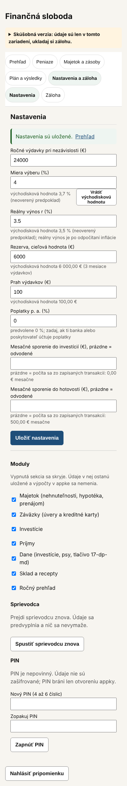
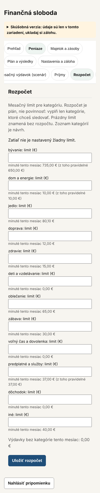
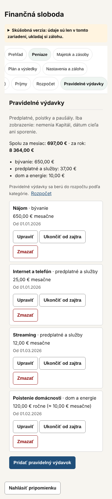
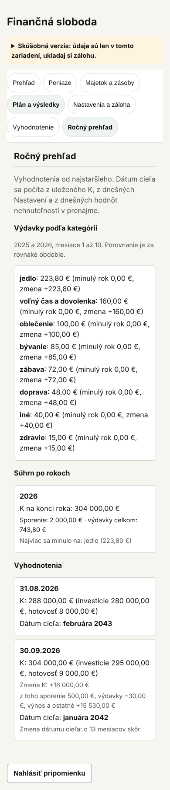
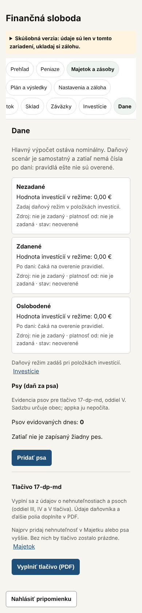

# 46 – Návrh: prehľadnejšie usporiadanie obrazoviek

> Stav: **návrh na schválenie** (2026-10-25). Kód sa zatiaľ nemení.
>
> Merané na vetve `claude/phase2-property-card` pri 390 × 844 px s testovacou zálohou (po D-290), pruh „Skúšobná verzia“ zbalený. Prehľad (D-283, D-289) a Transakcie (D-286, D-287) sa už upravili. Tento návrh rieši ostatné obrazovky a históriu v Transakciách.

## 1. Zásady pre všetky obrazovky

Vychádzajú z `docs/03` (nízka kognitívna záťaž, predvídateľnosť) a `docs/39` (jednotný štýl). Uplatnia sa rovnako na každej upravenej obrazovke:

1. **Najprv súhrn, potom detaily.** Hore jedna veta alebo číslo, ktoré odpovedá na otázku obrazovky, napríklad „Spolu za mesiac 697 €“.
2. **Zoznam: pri položke len Upraviť.** Ostatné akcie (Ukončiť, Zmazať, Prílohy) sú v úprave, ako v Transakciách (D-286). Zmazanie ostáva s potvrdením (D-199).
3. **Čo sa používa zriedka, je zbalené.** Zbalený blok má nadpis s „▾“ a sám sa rozbalí, keď v ňom je chyba alebo upozornenie.
4. **Prázdne veci sa nezobrazujú ako nuly.** Namiesto troch kariet „0,00 €“ jedna veta s tlačidlom na ďalší krok.
5. **Nič sa nemaže ani neskrýva natrvalo.** Všetky údaje ostávajú dostupné jedným ťuknutím. Výpočty sa nemenia.

## 2. Merania dnes (390 px)

| Obrazovka | Dĺžka stránky | Polia | Tlačidlá | Hlavný problém |
| --- | --- | --- | --- | --- |
| Transakcie | 4 084 px | 12 | 25 | História má všetky záznamy naraz a 4 filtre stále rozbalené. |
| Nastavenia | 2 403 px | 17 | 4 | Jeden dlhý formulár, pod ním Moduly, Sprievodca a PIN. |
| Rozpočet | 1 919 px | 12 | 1 | 12 polí na limity, aj pre kategórie bez výdavkov. |
| Mesačný výdavok | 1 915 px | 1 | 0 | V poriadku (D-290). |
| Ročný prehľad | 1 806 px | 0 | 0 | Porovnanie s minulým rokom pri každej kategórii aj vtedy, keď minulý rok nemá údaje („minulý rok 0,00 €, zmena +223,80 €“). |
| Pravidelné výdavky | 1 732 px | 0 | 13 | Pri každej položke 3 tlačidlá (Upraviť, Ukončiť od zajtra, Zmazať). |
| Dane | 1 675 px | 0 | 2 | Tri karty daňových režimov s nulami, keď nie sú investície s režimom. |
| Prehľad | 1 601 px | 7 | 1 | Už upravené. |
| Vyhodnotenie | 1 346 px | 3 | 5 | V poriadku. |
| Záloha | 1 145 px | 1 | 2 | „Obnovenie zo zálohy“ nie je nadpis; uloženie a obnova nie sú zreteľne oddelené. |
| Ostatné (6 obrazoviek) | 844 až 1 321 px | 0 až 2 | 0 až 3 | Bez zmeny. |

| Nastavenia | Rozpočet | Pravidelné výdavky | Ročný prehľad | Dane |
| --- | --- | --- | --- | --- |
|  |  |  |  |  |

## 3. Návrh po obrazovkách

### 3.1 Nastavenia (priorita 1)

Nové poradie v troch skupinách s nadpismi:
1. **Cieľ:** Ročné výdavky pri nezávislosti, Miera výberu. Vždy viditeľné (`docs/00`: predpoklady musia byť viditeľné a upraviteľné).
2. **Sporenie:** Mesačné sporenie do investícií a do hotovosti.
3. **Predpoklady výpočtu:** Reálny výnos, Poplatky, Rezerva, Prah výdavkov. Otázka 1: viditeľné, alebo zbalené?
4. Uložiť nastavenia.

Pod formulárom budú zbalené bloky Moduly, Sprievodca a PIN. Blok Moduly zostane aj na Prehľade (D-164).

### 3.2 Rozpočet (priorita 1)

1. **Súhrn hore:** plnenie plánu („Minuté 735 € z plánu 1 000 €“) alebo „Plán ešte nie je nastavený“.
2. **Zoznam kategórií ako text:** kategória, minuté tento mesiac a limit, ak je. Najprv kategórie s limitom alebo výdavkami, ostatné zbalené pod „Ďalšie kategórie (N) ▾“.
3. **Tlačidlo „Upraviť limity“** otvorí dnešný formulár s 12 poliami a Uložiť rozpočet.

### 3.3 Pravidelné výdavky (priorita 1)

1. Súhrn (spolu za mesiac a za rok, podľa kategórie) zostáva hore.
2. Pri položke len **Upraviť**. Ukončiť od zajtra a Zmazať (s potvrdením) budú v úprave, rovnako ako v Transakciách.
3. Pri 4 položkách to bude 4 tlačidlá namiesto 12.

### 3.4 Transakcie, história (priorita 1)

1. Filtre (typ, kategória, od, do) zbalené pod „Filter ▾“. Pri aktívnom filtri bude súhrn ukazovať, čo je zapnuté, a filter sa sám rozbalí.
2. Zobrazí sa posledných 10 záznamov a tlačidlo „Zobraziť staršie“. Otázka 2: 10, alebo 20?
3. Súčty („Súčet zobrazených transakcií“, „Výdavky podľa kategórie“) budú nad zoznamom ako dnes.

### 3.5 Ročný prehľad (priorita 2)

1. Poradie: **Súhrn po rokoch** (hlavná odpoveď), potom Výdavky podľa kategórií, potom Vyhodnotenia.
2. Porovnanie s minulým rokom sa pri kategórii ukáže, len keď má minulý rok údaje. Inak bude jedna veta „Minulý rok nemá zapísané výdavky, porovnanie sa ukáže neskôr.“
3. Vyhodnotenia budú zbalené pod „Vyhodnotenia (N) ▾“. Rovnaké údaje sú aj vo Vývoji na Prehľade (D-289).
4. Úvodná veta o dátume cieľa sa presunie k Vyhodnoteniam, ku ktorým patrí.

### 3.6 Dane (priorita 2)

1. Bez investícií s daňovým režimom sa namiesto troch kariet s nulami zobrazí jedna veta „Daňový režim zatiaľ nemá žiadna investícia.“ a odkaz Investície. Karty sa ukážu, keď bude aspoň jedna investícia s režimom.
2. Psy a Tlačivo 17-dp-md ostávajú ako samostatné časti s nadpismi.

### 3.7 Záloha (priorita 3)

Dve časti s nadpismi:
- **Uložiť zálohu:** dátum poslednej zálohy, upozornenie, heslo a Exportovať zálohu.
- **Obnoviť zo zálohy:** výber súboru, náhľad a nahradenie.

Mení sa len nadpis a oddelenie, poradie ostáva.

### 3.8 Rám appky (priorita 3, na zváženie)

Nadpis „Finančná sloboda“ zaberá asi 50 px na každej obrazovke. Môže byť menší. Otázka 3: zmenšiť, alebo nechať?

## 4. Kontrola rozhodnutí

| Rozhodnutie | Vzťah k návrhu |
| --- | --- |
| `docs/00`: miera výberu a ročné výdavky musia byť viditeľné a upraviteľné | Ostávajú vždy viditeľné hore v Nastaveniach. |
| D-106, D-131, D-136: rozpočet kategórií, zoznam a zaradenie | Kategórie a výpočet plnenia sa nemenia, mení sa len zobrazenie. |
| D-124: pravidelné výdavky a ich súčty | Súčty ostávajú. |
| D-164: Moduly na Prehľade | Ostávajú; v Nastaveniach budú zbalené. |
| D-199: zmazanie červené a s potvrdením | Ostáva, len sa presúva do úpravy. |
| D-201, nahradené D-286: tlačidlá pri riadku histórie | Pravidelné výdavky prevezmú pravidlo z D-286. |
| D-278: hlavná akcia na konci formulára | Dodržané: Uložiť je na konci formulárov, Upraviť limity otvorí formulár. |
| D-153: pilot | Mení sa len UI; zapíše sa do `docs/pilot/zmeny-pocas-pilota.md`. |

Žiadny konflikt.

## 5. Riziká

- **Zvyk:** testeri si zvykli na dnešné rozloženie. Zmenu treba spomenúť v návode pre testerov (`docs/41`).
- **Testy:** veľa E2E testov hľadá polia priamo (napr. limity v Rozpočte, filtre). Budú potrebovať krok „otvoriť“, ako pri doklade v D-286.
- **Skryté informácie:** zbalené bloky nesmú skryť chybu ani upozornenie, preto sa pri nich samy rozbalia.

## 6. Otázky na rozhodnutie

1. Nastavenia: predpoklady výpočtu (výnos, poplatky, rezerva, prah) **viditeľné so skupinovým nadpisom (odporúčam)**, alebo zbalené?
2. História transakcií: zobraziť **10 (odporúčam)** alebo 20 posledných záznamov?
3. Zmenšiť nadpis appky? **Nechať (odporúčam)**. Úspora je malá a nadpis pomáha orientácii.
4. Rozsah: **priority 1 a 2 naraz (odporúčam)**, alebo po jednej obrazovke so schválením každej?

## 7. Implementácia po schválení

Pre každú obrazovku:
1. Test najprv: E2E test nového poradia a toho, že zbalený blok sa sám rozbalí pri chybe alebo aktívnom filtri.
2. Úprava obrazovky a existujúcich testov, ktoré hľadajú presunuté polia.
3. Overenie: `tsc`, `vitest`, celé Playwright vrátane testov dostupnosti; snímky pri 320, 390 a 1280 px; porovnanie dĺžky stránky s oddielom 2.
4. Záznam do `docs/pilot/zmeny-pocas-pilota.md`, `docs/41` (návod pre testerov) a rozhodnutie do `decisions/Decisions.md`.

Rozsah: priority 1 asi 1 až 2 dni, priority 2 asi pol dňa.
